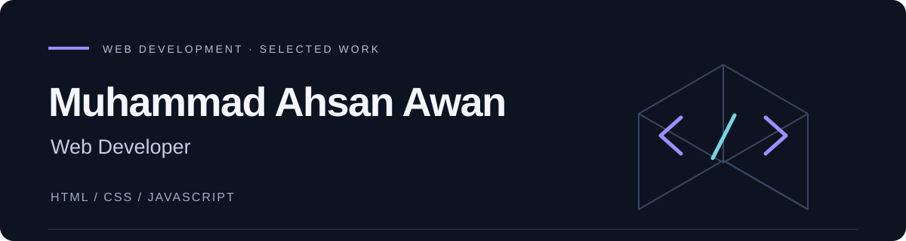

  

I build interactive websites with **HTML, CSS and JavaScript**. I'm a Computer Science learner turning ideas into working projects and developing my backend skills with PHP and MySQL.

**[Explore my portfolio](https://ahsanawan-dev.github.io/3d-portfolio/)** · [GitHub repositories](https://github.com/ahsanawan-dev?tab=repositories)

## Selected work

Two web projects with live demos, source code, and practical JavaScript interactions.

### 01 — VELORA Motors

A fictional automotive showroom with five cars, category filters, and a fullscreen photo gallery.

- **Built with:** HTML, CSS and JavaScript.
- **Implementation:** coordinated car and angle selection, dynamic photo updates, and keyboard controls in the gallery.
- **Explore:** [Live showroom](https://ahsanawan-dev.github.io/velora-car-showroom/) · [Code & setup guide](https://github.com/ahsanawan-dev/velora-car-showroom)

### 02 — Interactive Developer Portfolio

My personal portfolio with an animated CSS 3D cube, project previews, and responsive navigation.

- **Built with:** HTML, CSS and JavaScript.
- **Implementation:** CSS transforms, pointer interactions, reduced-motion support, and links to working projects.
- **Explore:** [Live portfolio](https://ahsanawan-dev.github.io/3d-portfolio/) · [Code & setup guide](https://github.com/ahsanawan-dev/3d-portfolio)

## Toolkit

| In my published projects | Developing next |
| --- | --- |
| HTML5, CSS3, JavaScript | PHP and MySQL |
| DOM interactions, CSS animation, page layouts | Database-backed applications |
| Git, GitHub, GitHub Pages | Backend validation and admin interfaces |

## Next milestone

Extend my frontend experience into a **PHP and MySQL application** with editable records and stored enquiries. Along the way, I'm improving accessibility, debugging, and Git workflows through practical changes.

## Connect

I'm interested in collaborating on useful web projects and learning with other developers. Explore my [portfolio](https://ahsanawan-dev.github.io/3d-portfolio/); for a project question or suggestion, [open an issue in the relevant repository](https://github.com/ahsanawan-dev?tab=repositories).

